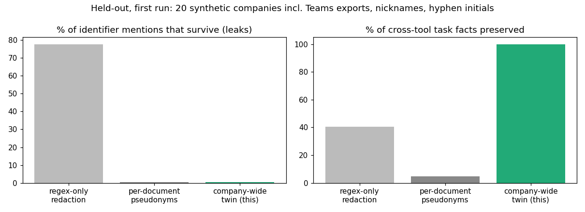

# Company-wide anonymization that keeps multi-tool tasks solvable

> Unofficial prototype by Kushagra Pratap Singh. Not affiliated with Ooak Data.
> Every company, person, client and identifier here is synthetic (generated; SIREN/SIRET and IBAN are checksum-valid fakes).

## The problem
Ooak Data anonymizes real company tool data into digital twins: "Names, dates, and proprietary content are transformed, but the structure, relationships, and complexity are preserved", with "Multi-tool coherence" ([ooakdata.com](https://ooakdata.com/)). Agents then train on multi-step, multi-tool tasks.

The same person shows up in many forms across tools:

| Tool | Form |
|---|---|
| directory | "Hélène Martin" |
| email signature | "Helene Martin" |
| Notion | "MARTIN Hélène" |
| Jira | "hmartin" |
| Slack | "@helene.m" |
| Gmail | "hmartin@…", "Bonjour Hélène" |

The same goes for dates and amounts. An anonymizer that works **document by document** gives each form a different pseudonym and each document its own date shift. Nothing leaks, but "who owns the ticket this email is about, and who's their manager?" becomes unsolvable, so the RL task rewards nonsense. **Regex-only** redaction keeps tasks partly solvable but leaks names, handles and Jira IDs.

## What I built
`twin/` (stdlib):
- **`corpus.py`:** a synthetic French company exported from Gmail, Slack, Jira, Notion (+ Teams in held-out):
  - people in many surface forms; clients with SIREN/SIRET, IBAN and phone;
  - invoice threads linking a Jira ticket, an email, a Slack message and a Notion page;
  - amounts in three formats ("28623 EUR", "€28,623.49", "28 623,49 €") and dates in four ("2025-04-18", "18/04/2025", "vendredi 18 avril 2025", "18 avr").
- **`anonymize.py`** (mode `twin`):
  1. Build **one identity graph** from the team directory: name ↔ email ↔ Slack handle ↔ Jira ID ↔ manager.
  2. Give each person **one keyed (HMAC) pseudonym**, rendered in every form: full, accent-free, "LAST First", "Last, First", "F. Last", email (same local-part pattern), handle, Jira ID.
  3. First names shared by two people become a neutral stand-in, so nothing leaks.
  4. Clients, domain and project key are mapped consistently.
  5. Identifiers are replaced by format- and checksum-valid fakes, mapped consistently.
  6. **One whole-week date shift per company** (weekdays and gaps survive), and **one amount scale per company** (equal amounts stay equal).

  Baselines: `perdoc` (the same detection, but a fresh mapping, shift and scale per document) and `regex` (mask emails, phones, IBAN, SIREN/SIRET only).
- **`audit.py`:**
  - **leaks:** every original name, accent-free name, email, local part, handle, Jira ID, client name, identifier and domain is searched for in the output;
  - **coherence:** the same solver runs on the original and on the output for each invoice thread (Jira assignee → directory → name and manager; do the Jira, email and Slack amounts agree; days between the Jira due date and the Notion deadline; is the email recipient the assignee). The output must give the same answers.

## Results: held-out, first run
20 new companies with things the anonymizer was never run on:
- a Teams export ("Last, First" display names);
- **nicknames** in greetings and chats (Lena for Hélène, Nico for Nicolas…);
- hyphenated-name initials ("JM Martin").

The config was frozen in git before the run (`heldout/config.json`, commit 42f2459). Raw output: `out/heldout_first_run.json`.

| | Identifier mentions that survive | Cross-tool task facts preserved |
|---|---|---|
| regex-only redaction | 4,424 / 5,692 | 282 / 695 |
| per-document pseudonyms | 32 / 5,692 | 33 / 695 |
| **company-wide twin (this)** | **32 / 5,692** | **695 / 695** |



**What leaked:** all 32 surviving mentions are **nicknames**: Nico (11), Lodie (5), Margot (4), Lena (4) and 3 more. They aren't derivable from the directory. The fix is a first-name → nickname lexicon (French and English) plus a greeting rule ("Bonjour X", "Hi X"), checked against the same leak audit. I haven't added it, so the held-out number stays honest. Hyphen initials ("JM Martin") didn't leak, because the surname is replaced, but "JM" stays.

One cosmetic fix after the run: unaccented names were getting the unaccented pseudonym ("Oceane" instead of "Océane"). Leaks and coherence are unchanged.

**Limits**
- **The identity graph comes from a team directory.** Real exports need it built from the tools' own user lists (Slack profiles, Jira users, Google directory). External contacts not in any directory need a model-based entity detector, with the same consistency rule.
- Text only: no attachments, images or code. Synthetic data. A real company has more surface forms than this generator.

## Run it
```
python demo.py                  # one invoice thread in 4 tools: original, per-document, regex-only, twin
python evaluate.py heldout      # the table above
python -m unittest discover tests
```
Python 3.10+, no dependencies (matplotlib only for `docs/plot.py`). On Windows, set `PYTHONIOENCODING=utf-8` for accented output.
